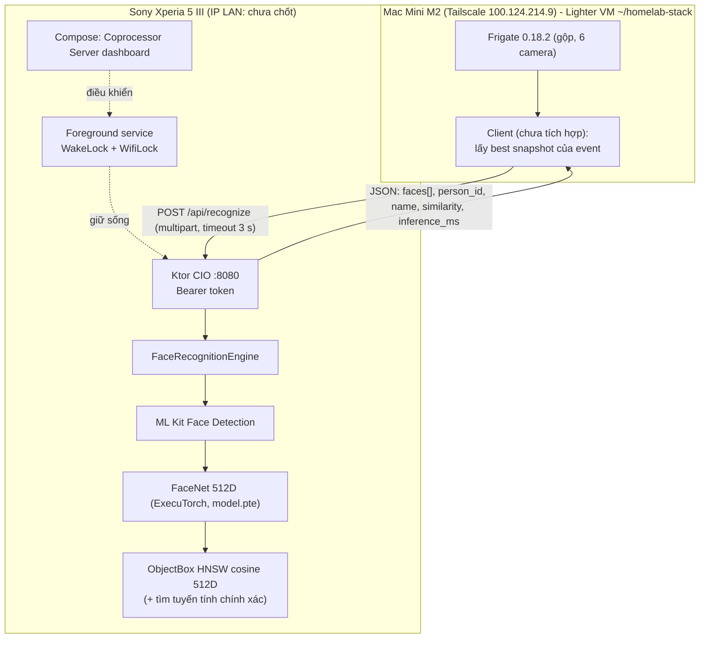

# Xperia AI Coprocessor (fork `feature/rest-api-coprocessor`)

Fork của [`shubham0204/OnDevice-Face-Recognition-Android`](https://github.com/shubham0204/OnDevice-Face-Recognition-Android)
tại [`nguyenhoangvannha/OnDevice-Face-Recognition-Android`](https://github.com/nguyenhoangvannha/OnDevice-Face-Recognition-Android),
nhánh `feature/rest-api-coprocessor`.

Mục tiêu: biến app nhận diện khuôn mặt offline thành một **REST API chạy nền 24/7** trên
Sony Xperia 5 III (Snapdragon 888, 8 GB RAM) để máy chủ homelab gửi ảnh snapshot sang và nhận
lại tên người quen. Toàn bộ suy luận chạy trên điện thoại, không gọi cloud.

App gốc (màn hình camera, thêm khuôn mặt, danh sách) **vẫn giữ nguyên**; phần mới nằm cạnh nó.

## Tài liệu

| File | Nội dung |
| --- | --- |
| [api.md](api.md) | Đặc tả REST API: endpoint, request/response, mã lỗi, giới hạn |
| [build-and-run.md](build-and-run.md) | Build trên Mac, cài APK, bật server, cấu hình điện thoại |
| [configuration-and-security.md](configuration-and-security.md) | Token, port, ngưỡng, foreground service, quyền, backup, quyền riêng tư |
| [web-test-page.md](web-test-page.md) | Trang web thử nghiệm tại `GET /` |
| [ci-and-release.md](ci-and-release.md) | GitHub Actions: CI, release APK đã ký, tag tự tạo, secret và nơi giữ keystore |
| [gpu-npu-survey.md](gpu-npu-survey.md) | Khảo sát tăng tốc GPU/NPU (Vulkan, QNN, LiteRT), khuyến nghị |
| [testing.md](testing.md) | Unit test, test bằng curl/Python, tiêu chí nghiệm thu |
| [progress-log.md](progress-log.md) | Nhật ký từng bước, commit, kết quả build |
| [../../clients/python/README.md](../../clients/python/README.md) | Client Python mẫu (stdlib) |

## Trạng thái các bước

| Bước | Nội dung | Trạng thái |
| --- | --- | --- |
| a | Docs scaffold + progress log | xong |
| b | `FaceRecognitionEngine` tách khỏi CameraX, nhận `Bitmap`/`ByteArray` | xong |
| c | Ktor CIO server: health/status/recognize/enroll/persons | xong (code + test JVM; server được khởi động ở bước d) |
| d | Foreground service, WakeLock, WifiLock, BootReceiver, quyền | xong (build + test JVM; chưa chạy trên máy thật) |
| e | Màn hình Compose "Coprocessor Server" | xong (build; chưa xem trên máy thật) |
| f | Client Python mẫu | xong (test với server giả; chưa gọi điện thoại thật) |
| 2.1 | `POST /api/persons/{id}/images` | xong |
| 2.2 | Trang web thử nghiệm `GET /` + API ngưỡng + header bảo mật | xong (test JVM; chưa mở trên máy thật) |
| 2.3 | GitHub Actions CI + release APK đã ký | xong |
| 2.4 | Khảo sát GPU/NPU (chỉ đọc) | xong (chưa đo trên máy thật) |
| 3.1 | Chạy tay release tự tạo tag (prerelease) | xong |
| 3.2 | Keystore + 4 secret GitHub | xong (bản gốc ở `~/.secrets/face-coprocessor/` trên MacBook) |

Chi tiết từng bước và commit: [progress-log.md](progress-log.md).

## Kiến trúc thực tế

### Bối cảnh homelab (đúng tại 2026-11-10)

- Kế hoạch gốc vẽ Frigate chạy trên TV box Armbian. **Thực tế từ 2026-11-09**, Frigate production
  (0.18.2, đã gộp, 6 camera) chạy trên **Mac Mini M2** (Tailscale `100.124.214.9`) trong Lighter VM,
  stack ở `~/homelab-stack`.
- Hai TV box Armbian (S905L, 1 GB RAM) là **Phố** `192.168.30.119` và **Quê** `192.168.50.130`.
  Không build nặng trên đó. Quê là chỉ đọc.
- IP `192.168.1.55` trong kế hoạch chỉ là ví dụ, **chưa kiểm chứng**.
- Nhánh này **không** sửa gì trên Mac Mini, Armbian hay Frigate.

### Câu hỏi tích hợp còn mở

1. Client chạy ở đâu: trong notifier trên Mac Mini (gần Frigate nhất) hay trên Armbian Phố?
2. Mac Mini/VM tới được điện thoại bằng đường nào: cùng LAN, hay cài Tailscale trên điện thoại?
   IP cố định (DHCP reservation) cho điện thoại cần chốt.
3. Camera nào được gửi ảnh sang nhận diện. Quy tắc riêng tư hiện có vẫn phải giữ: ảnh và kết quả
   của camera `*_private` chỉ đi luồng riêng (Telegram riêng), không vào nhóm gia đình.
4. Chỉ đăng ký khuôn mặt của người trong nhà đã đồng ý. Không dùng cho hàng xóm hay nơi công cộng.
5. Ngưỡng similarity cần hiệu chỉnh bằng ảnh camera thật (xem bên dưới).

## Lõi nhận diện (`engine/`)

Package `com.ml.shubham0204.facenet_android.engine`:

| File | Vai trò |
| --- | --- |
| `FaceRecognitionEngine.kt` | `recognize(bitmap, threshold, withLiveness)`, `enroll(name, bitmaps)`, `listPersons()`, `deletePerson(id)`. Dùng lại `BaseFaceDetector` (ML Kit), `FaceNet` (ExecuTorch), `ImagesVectorDB`/`PersonDB` (ObjectBox), `FaceSpoofDetector` |
| `ImageDecoding.kt` | `ByteArray` → `Bitmap` ARGB_8888, xoay theo EXIF, subsample để cạnh dài ≤ 1920 px; trả `null` nếu không phải ảnh |
| `SimilarityMath.kt` | Cosine similarity, so ngưỡng (bao gồm bằng), tìm láng giềng gần nhất. Không phụ thuộc Android, có unit test |
| `RecognitionModels.kt` | Kiểu kết quả không phụ thuộc Android (`FaceBox` thay cho `android.graphics.Rect`) để test lớp REST trên JVM |

Hành vi:

- Nhận diện dùng ML Kit chế độ **accurate** (camera trực tiếp vẫn dùng chế độ fast) và tìm kiếm **tuyến tính chính xác**
  (`flatSearch = true`) vì DB gia đình nhỏ.
- Mặt chạm mép ảnh bị bỏ qua (giữ nguyên `validateRect` của upstream).
- `name`/`person_id` chỉ có khi `similarity >= threshold`; `similarity` luôn là điểm của láng giềng gần nhất.
- Enroll: mỗi ảnh phải có đúng 1 khuôn mặt; người chỉ được lưu khi có ít nhất 1 ảnh hợp lệ.
- Liveness (anti-spoof) tắt mặc định: model MiniFASNet huấn luyện cho ảnh selfie, hiệu quả trên ảnh CCTV **chưa kiểm chứng**.

Thay đổi trên code upstream (camera UI vẫn chạy như cũ):

- `BaseFaceDetector`: thêm `getCroppedFace(Bitmap)`; `getAllCroppedFaces` thêm tham số `highAccuracy = false`.
- `FaceNet` và `FaceSpoofDetector`: khoá `Mutex` quanh suy luận, vì camera và API có thể chạy đồng thời
  (tính thread-safe của ExecuTorch `Module` không được tài liệu hoá; `Interpreter` của LiteRT không thread-safe).
- `ImagesVectorDB`: sửa lỗi `chunked(0)` khi < 4 bản ghi; thêm `count()`. `PersonDB`: thêm `get(id)`, `getAllOnce()`.
- `ImageVectorUseCase` dùng chung `SimilarityMath.cosineSimilarity` (ngưỡng camera vẫn `> 0.3` như upstream).

## Lớp REST (`coprocessor/`)

| File | Vai trò |
| --- | --- |
| `server/FaceApiModule.kt` | Route, auth bearer, đọc multipart có giới hạn, map lỗi → JSON, ghi log request |
| `server/ApiModels.kt` | DTO `@Serializable` (snake_case), `ApiLimits`, exception |
| `server/CoprocessorBackend.kt` | Interface giữa REST và app (giả lập trong test) |
| `server/FaceApiServer.kt` | Bọc `embeddedServer(CIO)`; `start()`/`stop()` |
| `AndroidCoprocessorBackend.kt` | Backend thật: decode ảnh, gọi engine, đọc ngưỡng, trạng thái máy |
| `CoprocessorSettings.kt` | Token/port/ngưỡng/trạng thái bật, trong SharedPreferences riêng |
| `TokenUtils.kt` | Sinh token 256-bit, so sánh constant-time |
| `CoprocessorState.kt` | Trạng thái server + 50 request gần nhất (cho dashboard) |
| `DeviceStatus.kt` | Pin, nhiệt độ pin, thermal status, heap, IPv4 của các interface |
| `service/CoprocessorService.kt` | Foreground service `specialUse`, WakeLock, WifiLock, chạy `FaceApiServer` |
| `service/BootReceiver.kt` | Tự khởi động lại sau reboot/cập nhật nếu server đang bật |

Đặc tả endpoint: [api.md](api.md).

## Dashboard "Coprocessor Server"

Mở từ màn hình camera, biểu tượng máy chủ (`Dns`) trên thanh trên cùng. Code:
`presentation/screens/coprocessor/CoprocessorScreen.kt`, `CoprocessorViewModel.kt`. Làm mới mỗi 5 giây.

| Khối | Nội dung |
| --- | --- |
| Server | Công tắc bật/tắt (Android 13+ xin quyền thông báo trước); trạng thái Stopped/Starting/Running/Failed + lỗi |
| Network | Mọi IPv4 không phải loopback theo interface (`wlan0`, `tun0` nếu có Tailscale) dạng `http://ip:port`; sửa port (áp dụng lần khởi động sau) |
| API token | Ẩn mặc định; hiện/ẩn; sao chép (đánh dấu sensitive trên Android 13+ để không hiện preview); tạo lại có hộp xác nhận |
| Similarity threshold | Slider 0.30–0.95, lưu khi thả tay, có hiệu lực ngay cho API; camera trực tiếp vẫn dùng 0.30 riêng |
| Device | Pin %, đang sạc, nhiệt độ pin, thermal status, heap của app, trạng thái tối ưu pin + nút xin bỏ tối ưu |
| Recent requests | 50 request gần nhất: giờ, method, path, status, `inference_ms`, số mặt / số người quen, tổng thời gian, IP nguồn |

Kế hoạch có "RAM": dashboard chỉ hiện heap Java của app, không phải RAM toàn máy.

## Stack thực tế của repo (khảo sát 2026-11-10, commit gốc `f6405d0`)

| Thành phần | Thực tế |
| --- | --- |
| Package / applicationId | `com.ml.shubham0204.facenet_android` |
| Build | Gradle 8.6 wrapper, AGP 8.4.1, Kotlin 2.0.0, KSP 2.0.0-1.0.24, JVM target 1.8 |
| SDK | compileSdk 34, targetSdk 34, minSdk 26 |
| UI | Jetpack Compose (BOM 2024.05.00), Material3, Navigation Compose 2.7.7 |
| DI | Koin 3.5.6 + Koin Annotations 1.3.1 (KSP, `KOIN_CONFIG_CHECK=true`) |
| Face detection | Google ML Kit `face-detection:16.1.7` (MediaPipe đã bị upstream gỡ ở `9d48d50`) |
| Embedding | **ExecuTorch** `org.pytorch:executorch-android:1.2.0`, model `model.pte` (VGGFace2 InceptionResnetV1, 512D, XNNPACK fp32, ~94 MB) tải từ HuggingFace bởi task `downloadModel` lúc build |
| Anti-spoof | MiniFASNet 2 model `.tflite` chạy bằng LiteRT `com.google.ai.edge.litert:*:1.1.2` |
| Vector DB | ObjectBox 5.4.2 (plugin 4.0.0), `@HnswIndex(dimensions=512, COSINE)` |
| Camera | CameraX 1.3.3, `ImageAnalysis.Analyzer` trong `FaceDetectionOverlay` |
| Settings | `SharedPreferences` qua `SettingsStore` |

## Khác biệt so với kế hoạch

| Kế hoạch | Thực tế / quyết định |
| --- | --- |
| Package `com.shubham0204.facerecognition.engine` | Dùng `com.ml.shubham0204.facenet_android.engine` (package thật) |
| FaceNet chạy TFLite (`facenet.tflite`), GPU/NNAPI | Upstream đã chuyển sang ExecuTorch (`model.pte`, CPU/XNNPACK). Không có file `.tflite` cho FaceNet. GPU/NNAPI cho FaceNet không áp dụng |
| Thêm `org.tensorflow:tensorflow-lite:2.16.1` | **Không thêm**: repo đã dùng LiteRT 1.1.2 (cùng package `org.tensorflow.lite`), thêm vào sẽ trùng class |
| Vector DB "Room / ObjectBox" | Chỉ có ObjectBox; không dùng Room |
| Ngưỡng cosine mặc định `0.70` | App gốc dùng `> 0.3`. Giữ mặc định API `0.70` theo kế hoạch nhưng **chưa kiểm chứng**: có thể làm sót người quen. Chỉnh được bằng slider; cần hiệu chỉnh bằng ảnh thật |
| `foregroundServiceType` dataSync | Dùng `specialUse` (lý do trong [configuration-and-security.md](configuration-and-security.md)) |
| `WIFI_MODE_FULL_HIGH_PERF` | Bị deprecate từ API 34 và tự chuyển thành `LOW_LATENCY` (chỉ có hiệu lực khi màn hình bật và app ở foreground). Vẫn dùng vì Xperia 5 III có thể chạy Android < 14 (phiên bản Android trên máy: **chưa kiểm chứng**) |
| CORS `anyHost()` | Không cài CORS: không có client trình duyệt |
| Middleware token chặn mọi route | Dùng Ktor `Authentication` (bearer) theo route; `/api/health` không cần token và chỉ trả `status` |
| `/api/health` trả model máy, pin, RAM | Thông tin phần cứng chuyển sang `/api/status` (cần token) |
| JSON dùng lẫn `inferenceTimeMs` và `inference_ms` | Thống nhất snake_case: `inference_ms` |
| "Nhiệt độ SoC" | Android không có API công khai đọc nhiệt độ SoC cho app thường; chỉ có nhiệt độ pin và `PowerManager` thermal status |
| Client ở `hosts/armbian-shared/` (repo DIY-NHVN-HOME) | Client mẫu nằm trong fork: `clients/python/`, chỉ dùng thư viện chuẩn Python, URL/token lấy từ biến môi trường |
| Độ trễ < 100 ms / < 350 ms | **Chưa kiểm chứng** trên máy thật |

Lỗi upstream phát hiện khi khảo sát: `ImagesVectorDB.getNearestEmbeddingPersonName(flatSearch = true)`
gọi `chunked(size / 4)`, bằng `chunked(0)` và ném lỗi khi DB có dưới 4 bản ghi. Sửa ở bước b.

Ghi chú: `gradlew` trong git không có bit thực thi (mode `100644`), nên chạy bằng `bash ./gradlew`.
